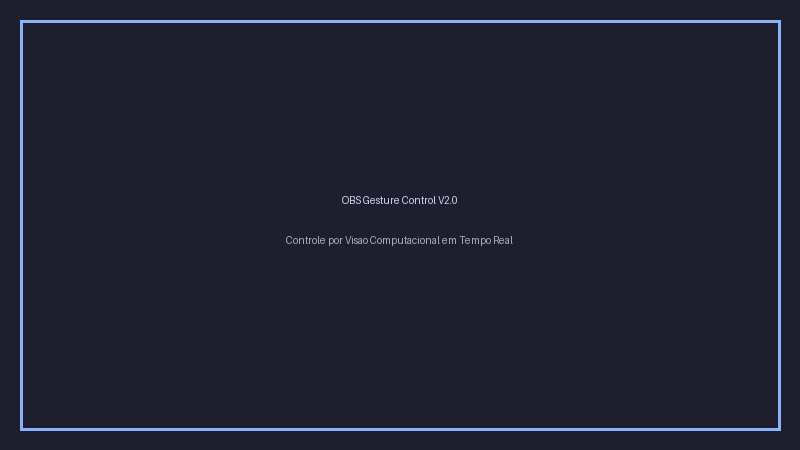

# 🖐️ OBS Gesture Control V2.0

O **OBS Gesture Control V2** é um sistema moderno e robusto de controle por visão computacional para o **OBS Studio**, permitindo alternar cenas, ligar/desligar fontes, controlar volume de áudio, iniciar/pausar transmissões e gravações através de gestos manuais em tempo real diante da webcam.



Toda a configuração é gerenciada através de uma **interface gráfica intuitiva**, com dados persistidos em formato JSON no diretório de configurações do usuário.

---

## 🏛️ Arquitetura do Sistema

O projeto é modular e desacoplado através de um barramento de eventos thread-safe:

* **`app.vision`**: Captura assíncrona de vídeo via OpenCV, rastreamento de pontos com Google MediaPipe Tasks API, extração geométrica contínua e motor de decisão com anti-oscilação, janela de N frames e cooldown por gesto.
* **`app.obs`**: Gerenciador de conexão com OBS Studio via WebSocket 5.x (`obsws-python`), com heartbeat de monitoramento de integridade, reconexão transparente e executor assíncrono em fila dedicada (`ThreadPoolExecutor`).
* **`app.config`**: Gerenciamento de configurações com validação estrita (clamps), escrita atômica com backup automático contra corrupção e suporte a múltiplos perfis independentes.
* **`app.gui`**: Interface moderna construída sobre CustomTkinter, atualizada de forma segura por fila thread-safe (`Queue`) e sem congelamentos na thread de vídeo.
* **`app.core`**: EventBus desacoplado e logging centralizado com gravação rotativa em arquivo (`logs/app.log`) e encaminhamento para a interface.

---

## 🚀 Funcionalidades Principais

* **8 Gestos Pré-definidos com Pontuação Contínua:**
  1. ✌️ **Peace (Paz)**
  2. 👍 **Thumbs Up (Positivo)**
  3. 👎 **Thumbs Down (Negativo)**
  4. 🖐️ **Open Hand (Mão Aberta)**
  5. ✊ **Fist (Punho Fechado)**
  6. ☝️ **Point (Apontar)**
  7. 🤟 **Love-You (Rock)**
  8. 🤏 **Pinch (Pinça)**
* **Descoberta Automática de Cenas e Fontes do OBS:** Consulta em tempo real das cenas e fontes configuradas.
* **16 Ações Configuráveis:** Alternância de cenas, controle de visibilidade de fontes, mute/unmute e volume em dB, controle de stream/gravação e comando de terminal (SO).
* **Mecanismos Anti-Falso Positivo:** Janela de N frames consecutivos de confirmação, filtro "soltar para rearmar" e cooldown independente por gesto.
* **Rastreamento de Mão Preferida:** Suporte à escolha de mão ativa (qualquer, esquerda ou direita) com compensação de espelhamento.
* **Ferramenta de Calibração Interativa:** Medição estatística de estabilidade visual e recomendação de sensibilidade e frames com aplicação direta ao perfil.
* **Modo Teste Seguro:** Simula o disparo de gestos e exibe feedback no painel sem executar ações reais no OBS.

---

## 📦 Instalação e Execução

### Requisitos Prévios
* **Python:** Versão 3.10, 3.11 ou 3.12.
* **OBS Studio:** Versão 28.0 ou superior (com WebSocket 5.x integrado).
* **Webcam:** Webcam USB ou câmera virtual.

---

### 1. Ativação do OBS WebSocket
1. No **OBS Studio**, acesse o menu **Ferramentas** -> **Configurações do Servidor WebSocket**.
2. Marque a opção **Ativar Servidor WebSocket**.
3. Anote a **Porta do Servidor** (padrão: `4455`) e defina sua **Senha de Autenticação** (ou desative a autenticação caso opte por conexão sem senha).

---

### 2. Execução

#### No Windows:
Você pode iniciar diretamente com dois cliques no executável em lote:
```cmd
run.bat
```
Ou manualmente pelo Prompt / PowerShell:
```powershell
# Criar e ativar o ambiente virtual
python -m venv .venv
.\.venv\Scripts\activate

# Instalar dependências
pip install -r requirements.txt

# Executar a aplicação
python main.py
```

#### No Linux / macOS:
```bash
# Criar e ativar o ambiente virtual
python3 -m venv .venv
source .venv/bin/activate

# Instalar dependências
pip install -r requirements.txt

# Executar como script ou pacote
python3 main.py
# ou:
python3 -m app
```

---

## 🧪 Testes Automatizados e Qualidade de Código

O repositório inclui uma suíte completa de testes unitários e de integração utilizando `pytest` e linter `ruff`:

```bash
# Executar a suíte de testes
pytest

# Executar checagem de código
ruff check .
```

---

## 🛡️ Privacidade e Segurança Local

* O processamento de imagem é executado **100% LOCALMENTE** no seu processador via MediaPipe, sem envio de frames ou dados para servidores externos.
* ⚠️ **Aviso de Segurança sobre Comandos do Sistema:** A ação `Comando Personalizado (SO)` executa comandos de terminal com privilégios do usuário logado. Configurações e perfis compartilhados por terceiros devem sempre ser revisados antes do uso.

---

## 📄 Licença

Distribuído sob a licença MIT. Consulte o arquivo [LICENSE](LICENSE) para mais detalhes.
